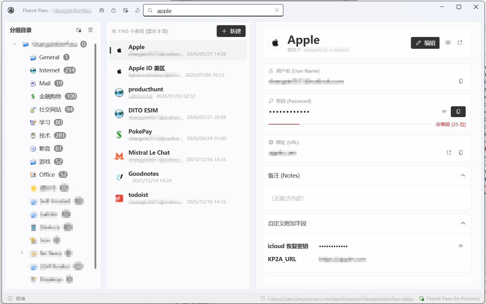

# Fluent Pass

<p align="center">
  <a href="README.md">简体中文</a> | <a href="README.zh-TW.md">繁體中文</a> | <a href="README.en.md">English</a> | <a href="README.ja.md">日本語</a>
</p>

<p align="center">
  
</p>

<p align="center">
  <strong>专为经典 KeePass 2.x 打造的 Windows 11 Fluent Design (Mica / Acrylic) 现代化桌面交互插件</strong>
</p>

<p align="center">
  <a href="https://github.com/YoungSx/fluentpass/releases"></a>
  
  
  
  <a href="LICENSE"></a>
</p>

---

## 📖 简介

**Fluent Pass** 是一款运行在 KeePass 官方进程内的现代化界面插件。它使用微软官方 **Fluent Design System (WPF-UI)** 重新设计了桌面交互视窗，赋予经典稳健的 KeePass 2.x 宛如 Windows 11 原生应用般的云母（Mica）半透明美感与丝滑体验。

无需繁琐配置、无需启动任何后台服务，只需将单个 `.dll` 文件放入 KeePass 插件目录，即可立刻告别复古的 WinForms 界面，拥抱兼具美观与极致安全的现代密码管理体验。

---

## ✨ 界面预览

<p align="center">
  
</p>

> 💡 **三栏式工作流**：左侧分组导航树清晰直观，中间条目列表支持毫秒级模糊搜索与平滑虚拟化滚动，右侧详情卡片支持敏感信息保护、一键复制、行内即时编辑与官方密码生成器唤起。

---

## 🌟 核心特色

### 🎨 灵动的 Windows 11 视觉体验
- **Mica 云母材质**：原生适配 Windows 11 DWM 高清半透明材质与圆角窗口。
- **深浅色主题自由切换**：支持「深色模式 (Dark)」、「浅色模式 (Light)」与「跟随系统 (System)」实时无缝切换，夜间使用不刺眼。
- **沉浸式现代 TitleBar**：集成全局搜索框、快捷锁定、即时保存与主题切换，窗口标题与数据库状态一目了然。

### ⚡ 官方同进程原生集成，零性能损耗
- **零跨进程通信 (Zero IPC)**：以官方标准插件形式直接驻留 `KeePass.exe` 进程内部，与宿主共享原生内存引用。
- **极速轻巧，即开即用**：不依赖独立进程、不拉起后台服务，内存占用极低，随 KeePass 秒级启动。
- **生态 100% 兼容**：完全不干扰现有生态，浏览器自动填充插件（如 KeePassXC-Browser、KeePassRPC）与云同步（WebDAV / 网盘）均不受任何影响。

### 🔒 坚如磐石的隐私与安全防护
- **100% 官方内核加密**：KDBX 4 数据库加解密、文件持久化保存完全由官方 `KeePassLib` 执行，不重写、不破坏任何底层安全逻辑。
- **内存明文物理级防御**：非展开状态下的密码在内存中绝不解密为托管堆 `string`，杜绝内存 Dump 泄密。
- **密码隐私按需查看**：查看明文密码需主动点击眼睛图标，**10 秒后自动重新遮蔽**，防止离开座位时旁人窥视。
- **剪贴板延时自动清空**：深度集成 KeePass 官方 `ClipboardUtil`，复制密码后系统托盘倒计时自动清理剪贴板。
- **编辑安全备份机制**：任何条目就地修改前，严格自动创建历史副本（`CreateBackup`），历史记录随手可查。

### 🛠️ 便捷高效的操作流
- **三栏式清晰布局**：分组树、凭据列表与详情面板同屏展示，告别多层弹出对话框。
- **毫秒级模糊搜索**：支持在标题、用户名、网址、备注等字段中即时过滤目标条目。
- **行内就地快速编辑**：直接在右侧卡片修改凭据信息并按 `Ctrl+S` 即时保存，亦可一键唤起 KeePass 原版完整编辑面板。
- **内置官方强密码生成器**：随时在编辑时呼出官方 `PwGeneratorForm`，一键生成高强度复杂随机密码。

---

## 📥 下载与安装

### 系统与环境要求
- **操作系统**：Windows 11 / Windows 10 (1809 及以上)
- **KeePass 宿主**：[KeePass 2.x](https://keepass.info/) (官方安装版或 Portable 便携版)
- **运行时环境**：.NET Framework 4.8（Windows 10/11 系统已原生内置，**无需额外安装**）

### ⚡ 方式一：PowerShell 一键安装（推荐）

打开 Windows PowerShell，复制并执行以下一行命令即可自动完成最新 Release 版本的下载、检测安装路径与安全部署：

```powershell
irm https://raw.githubusercontent.com/YoungSx/fluentpass/main/scripts/install.ps1 | iex
```

> [!TIP]
> - **权限自动提权**：如果 KeePass 安装在 `C:\Program Files` 目录下，脚本会自动弹出 Windows 标准 UAC 提权请求，无需手动使用“以管理员身份运行”打开终端；
> - **安装后自动启动**：若希望安装完成后直接唤起 KeePass，可传入 `-Launch` 参数：
>   ```powershell
>   & { irm https://raw.githubusercontent.com/YoungSx/fluentpass/main/scripts/install.ps1 } | iex -ArgumentList "-Launch"
>   ```
> - **国内网络加速**：若遇到直连 GitHub 访问受限或超时，可使用内置镜像代理加速通道：
>   ```powershell
>   irm https://ghp.ci/https://raw.githubusercontent.com/YoungSx/fluentpass/main/scripts/install.ps1 | iex
>   ```

### 📦 方式二：手动下载与安装

1. **下载插件**：
   前往 [Releases 页面](https://github.com/YoungSx/fluentpass/releases) 下载最新编译好的单文件 `FluentPass.dll` 或 Zip 安装包。

2. **放入 Plugins 文件夹**：
   将下载好的 `FluentPass.dll` 复制到 KeePass 的 `Plugins` 目录下：
   - **默认安装路径**：`C:\Program Files\KeePass Password Safe 2\Plugins`
   - **便携版路径**：KeePass 解压目录中的 `Plugins` 文件夹
   - **用户数据路径**：`%APPDATA%\KeePass\Plugins`

3. **启动 KeePass**：
   启动 KeePass 并解锁数据库，Fluent Pass 现代化窗口将自动呈现！
   > 📌 你也可以随时通过 KeePass 主菜单的 **`工具 (Tools)` -> `Fluent Pass`** 重新打开或前置窗口。

---

## ⌨️ 常用快捷键

| 快捷键 | 功能说明 |
| :--- | :--- |
| <kbd>Ctrl</kbd> + <kbd>S</kbd> | 即刻保存数据库修改 |
| <kbd>Ctrl</kbd> + <kbd>L</kbd> | 立即锁定数据库 |
| <kbd>Ctrl</kbd> + <kbd>F</kbd> | 快速聚焦顶部全局搜索栏 |
| <kbd>Ctrl</kbd> + <kbd>B</kbd> | 快速复制选中条目的用户名 |
| <kbd>Ctrl</kbd> + <kbd>C</kbd> | 复制选中条目的密码（带自动倒计时清空） |
| <kbd>Esc</kbd> | 取消编辑状态 / 清空搜索 |

---

## ❓ 常见问题 (FAQ)

<details>
<summary><strong>Q: Fluent Pass 会访问互联网或上传我的密码吗？</strong></summary>

**A: 绝对不会。** Fluent Pass 是一个 100% 离线运行的开源 KeePass 插件，项目中没有任何网络请求代码、遥测上报或埋点分析。所有加解密与读写均直接在你的本地计算机内由 KeePass 官方库完成。
</details>

<details>
<summary><strong>Q: 我的数据库文件会被破坏吗？会不会发生丢失？</strong></summary>

**A: 不会。** Fluent Pass 仅作为顶层视图外壳，底层持久化和文件读写完全交由官方 `KeePassLib` 安全写入机制处理。同时，在编辑保存条目前会自动生成事务备份副本，即使误改也可在「历史版本」中随时恢复。
</details>

<details>
<summary><strong>Q: 还能同时使用 KeePass 原版窗口或者其他插件吗？</strong></summary>

**A: 完全可以。**
1. Fluent Pass 顶部工具栏提供「切换原版 KeePass 窗口」按钮，点击即可随时展开或隐藏原版 WinForms 窗口；
2. 由于运行在同一进程内，所有浏览器填充插件（KeePassXC-Browser / KeePassRPC 等）以及同步插件均完全正常工作。
</details>

<details>
<summary><strong>Q: 如何彻底卸载 Fluent Pass？</strong></summary>

**A: 极简绿色。** 只需退出 KeePass，然后在 KeePass 的 `Plugins` 目录下删除 `FluentPass.dll` 即可，不会对你的系统注册表或数据库产生任何残留。
</details>

---

## 🏗️ 开发者指南与架构设计

如果你是开发者或希望从源码构建 Fluent Pass，请参考以下指南。

### 目录结构

```
fluentpass/
├── .github/
│   └── workflows/
│       ├── ci.yml                          # 分层并行 CI 质量门禁流水线
│       └── release.yml                     # 自动化生产发版与产物打包流水线
├── assets/                                 # 官方 Logo 与高清界面截图
│   ├── icon.png                            # 1254x1254 品牌矢量源图
│   └── screenshot.png                      # Windows 11 Mica 材质主视窗截图
├── scripts/
│   ├── install.ps1                         # PowerShell 一键在线安装最新 Release 脚本
│   ├── release.ps1                         # Windows / PowerShell 标准化发版脚本
│   └── release.sh                          # Linux / macOS / Bash 标准化发版脚本
├── ARCHITECTURE.md                         # 架构设计、铁律与功能边界白皮书 (必读)
├── RELEASE.md                              # 完整发版操作指南与核查清单 (必读)
├── src/
│   └── FluentPass/
│       ├── Common/
│       │   ├── IdleNotificationThrottle.cs # 原生闲置计时器节流同步机制
│       │   ├── IconConverterHelper.cs      # 官方图标与 WPF ImageSource 转换器
│       │   ├── MessageService.cs           # 统一消息提示封装
│       │   └── Wpf32Window.cs              # WinForms/WPF 交叉模态 Owner 互操作适配器
│       ├── ViewModels/
│       │   ├── MainViewModel.cs            # 驱动状态与数据生命周期同步
│       │   ├── GroupItemViewModel.cs       # 树形分组视图模型
│       │   ├── EntryItemViewModel.cs       # 凭据列表虚拟化项 (零明文拷贝)
│       │   └── EntryDetailViewModel.cs     # 详情卡片与内联编辑视图模型
│       ├── Views/
│       │   ├── FluentMainWindow.xaml       # Mica 材质与三栏布局主窗口
│       │   └── FluentMainWindow.xaml.cs    # 输入监听、键盘导航与互操作
│       ├── Resources/
│       │   └── AppIcon.ico                 # 包含 16x16~256x256 全尺寸的高清应用图标
│       ├── FodyWeavers.xml                 # Costura 依赖嵌入配置 (排除宿主 KeePass)
│       ├── FluentPass.csproj               # SDK-Style net48 项目文件
│       └── PluginEntry.cs                  # KeePass 插件主入口 (FluentPassExt)
├── tests/
│   └── FluentPass.Tests/                   # 自动化测试与 STA 宿主测试工程 (76 项测试用例)
├── build.ps1                               # 一键本地构建、部署与调试脚本
└── README.md
```

### 核心架构原则

1. **同进程零 IPC 损耗**：以官方插件 (`.dll`) 形式直接驻留 `KeePass.exe` 进程内（.NET Framework 4.8 STA 线程），共享内存引用，绝不引入跨进程通信或明文数据序列化传输。
2. **核心业务 100% 复用**：KDBX 加解密、文件持久化与云同步、剪贴板保护、自动输入（Auto-Type）全部直接调用原生 `KeePassLib` / `IPluginHost`。
3. **敏感内存物理级防御**：直接持有 `PwEntry` 原生指针，未展开查看的密码在 ViewModel 中绝不解密为 CLR `System.String`，杜绝托管堆残留。
4. **单文件即插即用分发**：使用 SDK-style 项目与 `Costura.Fody` 将 `WPF-UI` (4.x)、`CommunityToolkit.Mvvm` 等资源全部嵌入单一 `FluentPass.dll`，放入官方 `Plugins` 目录即可开箱即用。

> ⚠️ **开发与 PR 规范**：详细设计原则、功能范围边界（要做与绝对不做项）、以及 PR 审查铁律请阅读：  
> 👉 **[架构设计与工程约束白皮书 (ARCHITECTURE.md)](ARCHITECTURE.md)**

### 本地编译与构建

#### 依赖环境
- .NET 8 / 9 / 10 SDK（内置 MSBuild 支持 SDK-style `net48` 编译）
- 官方 KeePass 2.x 安装（默认路径 `C:\Program Files\KeePass Password Safe 2`）

#### 一键构建 (Release)
在项目根目录运行 PowerShell：
```powershell
.\build.ps1 -Configuration Release
```

#### 自动部署并启动调试
```powershell
# 以管理员权限运行以自动将 .dll 复制到 Plugins 目录并拉起 KeePass
.\build.ps1 -Configuration Release -Install -Run
```

### 自动化测试与质量保障

项目包含专属的 NUnit 自动化测试工程 `tests/FluentPass.Tests`，严格遵循**测试金字塔黄金分层准则**（单元测试 ~70%、集成测试 ~20%、冒烟测试 ~10%）：

```powershell
# 1. 运行快速反馈单元测试 (~70% 黄金层)
dotnet test tests\FluentPass.Tests\FluentPass.Tests.csproj --filter "Category=Unit"

# 2. 运行深层业务集成测试 (~20% 黄金层)
dotnet test tests\FluentPass.Tests\FluentPass.Tests.csproj --filter "Category=Integration"

# 3. 运行端到端与宿主冒烟测试 (~10% 黄金层)
dotnet test tests\FluentPass.Tests\FluentPass.Tests.csproj --filter "Category=Smoke"

# 运行全量测试套件 (76 项测试用例全部通过)
dotnet test tests\FluentPass.Tests\FluentPass.Tests.csproj
```

- **单元测试 (Unit Tests)**：
  - `ConvertersTests`：XAML 转换器与异常防御。
  - `IdleThrottleTests`：用户高频输入节流与防闲置误锁算法。
  - `NotificationServiceTests`：线程安全消息队列与状态重置。
  - `AttachmentItemViewModelUnitTests`：文件大小人类可读格式化（B、KB、MB）。
  - `CustomFieldItemViewModelUnitTests`：敏感自定义字段掩码隐藏与按需揭示。
  - `EntryHistoryItemViewModelUnitTests`：历史记录恢复与空标题安全回退。
  - `EntryItemViewModelUnitTests`：内存零泄露、80字符截断与 UUID 等价性。
  - `IconConverterHelperUnitTests`：冻结位图源生成与缓存释放。
  - `MessageServiceUnitTests`：弹窗阻断测试状态控制。
- **集成测试 (Integration Tests)**：
  - `EntrySecurityTests`：验证内存安全铁律，列表属性绝对不解密明文密码；验证密码按需展开及隐藏时立即置空释放；敏感自定义字段默认掩码。
  - `EntryTransactionBackupTests`：验证保存修改前严格在历史记录集合中新增备份副本，确保数据可恢复。
  - `FilterAndSearchTests`：验证标题、用户名、网址、备注等字段的实时模糊搜索过滤与全库搜索。
  - `GroupHierarchyTests`：验证树形分组层级递归构建与条目统计向上冒泡。
  - `Phase3Tests`：密码熵值评估、条目历史恢复与回收站永久清空墓碑机制。
  - `StateSyncAndSaveTests`：数据库开启、修改、关闭全双工状态同步与持久化。
- **冒烟与跨平台测试 (Smoke Tests)**：
  - `SmokeTests`：验证插件接口版本、KeePass 规范 16x16 小图标流与 Mica 窗口 XAML 资源完整性、跨平台守卫无崩溃。
  - `PluginLoadingDiagnosticsTests`：KeePass 原生插件管理器反射装配诊断。
  - `CI Linux Headless Smoke`：GitHub Actions 环境下 Mono + KeePass2 + Xvfb 跨平台虚拟桌面真实无头启动冒烟。

### 🚀 生产发版流程与脚本

本项目拥有标准化的 GitHub Actions Release 流水线（自动打包 Zip、生成 SHA256 校验和、自动生成发布说明）：

```powershell
# PowerShell (Windows)
# 1. 演练模式（校验 Git 状态与版本号格式）
.\scripts\release.ps1 -Version "v1.0.0" -DryRun

# 2. 正式发版并推送触发 CI 流水线
.\scripts\release.ps1 -Version "v1.0.0" -Push
```

```bash
# Bash (Linux / macOS)
./scripts/release.sh v1.0.0 --dry-run
./scripts/release.sh v1.0.0 --push
```

> 📖 **完整发版指引**：发版前自查核对清单、GitHub Actions Web 手动触发方式、发布产物说明及线上回滚指南，详见：  
> 👉 **[发版操作指南 (RELEASE.md)](RELEASE.md)**

---

## 📄 开源许可证

本项目采用 [MIT License](LICENSE) 开源许可证。
欢迎提交 Issue 与 Pull Request 共同改进！

---

## 🤝 推广致谢

感谢以下社区平台在本项目推广与交流过程中给予的支持（排名不分先后）：

- [SourceForge](https://sourceforge.net/)
- [LINUX DO](https://linux.do/)
