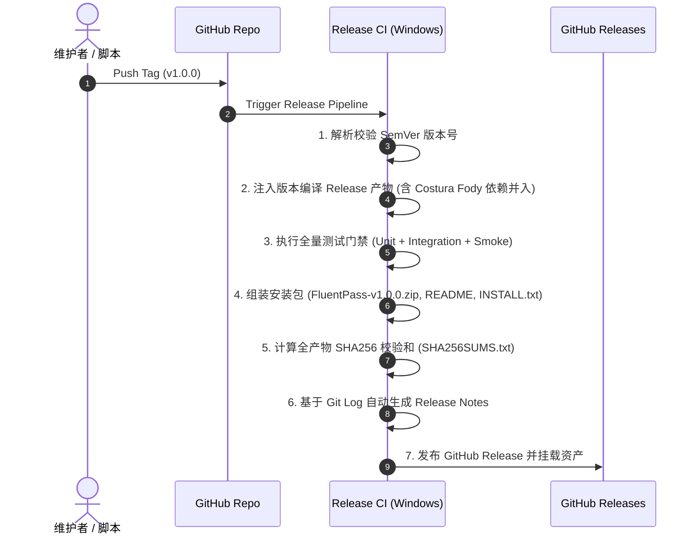

# Fluent Pass 发版操作指南 (Release Guide)

本文档面向项目维护者与发版负责人，详细阐述 Fluent Pass 的版本发布规范、操作流程、自动化 CI 流水线及异常回滚策略。

---

## 目录
1. [发版前核查清单 (Pre-Release Checklist)](#1-发版前核查清单-pre-release-checklist)
2. [发版方式一：使用自动化发版脚本（推荐）](#2-发版方式一使用自动化发版脚本推荐)
3. [发版方式二：GitHub Web 界面手动触发 (Workflow Dispatch)](#3-发版方式二github-web-界面手动触发-workflow-dispatch)
4. [发版方式三：原生 Git Tag 触发](#4-发版方式三原生-git-tag-触发)
5. [Release CI 自动化流水线执行机制](#5-release-ci-自动化流水线执行机制)
6. [发版后验证 (Post-Release Verification)](#6-发版后验证-post-release-verification)
7. [版本回滚与异常处理指南](#7-版本回滚与异常处理指南)

---

## 1. 发版前核查清单 (Pre-Release Checklist)

在发起任何正式版本或预发布版本前，请逐项确认：

- [ ] **分支检查**：当前分支是否为 `master` 或 `main`，且已合并所有待发布功能与修复。
- [ ] **工作区清洁度**：本地是否有未提交的更改或未跟踪文件（`git status`）。
- [ ] **架构铁律核验**：确认未违背 [`ARCHITECTURE.md`](ARCHITECTURE.md) 中的 5 项核心铁律（同进程零 IPC、内存敏感物理防护、依赖官方加解密等）。
- [ ] **全量自动化测试**：本地或 CI 上 76 项测试用例（单元、集成、冒烟）100% 通过：
  ```powershell
  dotnet test tests\FluentPass.Tests\FluentPass.Tests.csproj
  ```
- [ ] **版本号规范**：遵循语义化版本规范 [SemVer 2.0.0](https://semver.org/)，例如：
  - 正式版：`v1.0.0`, `v1.1.0`, `v2.0.0`
  - 预发布/候选版：`v1.0.0-rc.1`, `v1.0.0-beta.1`

---

## 2. 发版方式一：使用自动化发版脚本（推荐）

项目在 `scripts/` 目录下提供了跨平台的标准化发版脚本，内部集成了**工作区清洁度检查**、**版本正则校验**、**本地/远端 Tag 冲突校验**与**自动推流**。

### 2.1 Windows 环境 (PowerShell)

使用 [`scripts/release.ps1`](scripts/release.ps1)：

```powershell
# 步骤 1：演练模式 (Dry-Run)，验证前置检查项，不修改 Git 状态
.\scripts\release.ps1 -Version "v1.0.0" -DryRun

# 步骤 2：确认无误后，正式打 Tag 并推送到 GitHub 远端触发发版 CI
.\scripts\release.ps1 -Version "v1.0.0" -Push
```

> **参数说明**：
> - `-Version` (必填)：目标版本号（如 `v1.0.0` 或 `1.0.0`，脚本会自动补齐前导 `v`）。
> - `-DryRun` (可选)：演练模式，仅做合规性核验。
> - `-Push` (可选)：自动执行 `git push origin <tag>`。若未指定此参数，Tag 仅创建在本地。
> - `-Remote` (可选)：远端仓库名，默认为 `origin`。

### 2.2 Linux / macOS 环境 (Bash)

使用 [`scripts/release.sh`](scripts/release.sh)：

```bash
# 步骤 1：演练模式
./scripts/release.sh v1.0.0 --dry-run

# 步骤 2：正式发布并推送到远端
./scripts/release.sh v1.0.0 --push
```

---

## 3. 发版方式二：GitHub Web 界面手动触发 (Workflow Dispatch)

如果需要在不直接推送 Git Tag 的情况下发起发布（例如发布测试草稿或需要自定义参数）：

1. 打开 GitHub 仓库，导航至 **Actions** 选项卡。
2. 在左侧工作流列表中选择 **`Release Pipeline`**。
3. 点击右侧的 **Run workflow** 下拉按钮：
   - **Release Tag**：输入版本标签，例如 `v1.0.0` 或 `v1.0.0-rc1`。
   - **Mark as Pre-release**：若为预发布版本，勾选此项。
   - **Create as Draft Release**：若希望先生成草稿人工审核后再公开，勾选此项。
4. 点击绿色按钮 **Run workflow** 开始执行。

---

## 4. 发版方式三：原生 Git Tag 触发

如果你习惯使用纯 Git 命令行，也可以直接通过以下标准命令触发：

```bash
# 1. 确保在主分支最新提交
git checkout master
git pull origin master

# 2. 创建带注释的签注标签 (Annotated Tag)
git tag -a v1.0.0 -m "Release v1.0.0"

# 3. 推送标签至 GitHub
git push origin v1.0.0
```

GitHub Actions 监听到 `v*` 格式的 Tag 推送后，将自动唤醒 `Release Pipeline`。

---

## 5. Release CI 自动化流水线执行机制

`.github/workflows/release.yml` 流水线被触发后，会自动执行以下全套工程闭环：



### 产物归档说明
每次发布成功后，GitHub Release 页面将包含以下 3 项标准文件：
1. **`FluentPass-vX.Y.Z.zip`**：推荐普通用户下载的完整包，内含 `FluentPass.dll`、使用文档与 `INSTALL.txt` 安装指南。
2. **`FluentPass.dll`**：单文件绿色插件，供熟练用户直接复制到 `KeePass/Plugins/` 目录升级。
3. **`SHA256SUMS.txt`**：所有产物的 SHA256 哈希值，供安全审计与完整性核对。

---

## 6. 发版后验证 (Post-Release Verification)

发布流水线成功后，发版负责人应进行线上验证：

1. **检查 Release 页面**：
   访问 `https://github.com/YoungSx/fluentpass/releases`，确认对应 Tag 的 Release 状态正常，说明文字与资产列表无误。
2. **校验 SHA256 哈希**：
   本地下载 `FluentPass.dll` 并核对哈希值：
   ```powershell
   Get-FileHash .\FluentPass.dll -Algorithm SHA256
   ```
   与 `SHA256SUMS.txt` 中的记录严格一致。
3. **物理机冒烟验证**：
   将下载的 `FluentPass.dll` 丢入本地原生 KeePass 2.x 的 `Plugins` 目录，启动 KeePass，确认：
   - 菜单栏 **`工具 (Tools)` -> `Fluent Pass`** 正确出现。
   - 点击可拉起 Windows 11 Mica 现代化主视窗。
   - 数据库正常解锁与凭据查看无报错。

---

## 7. 版本回滚与异常处理指南

### 7.1 本地脚本校验未通过
- **工作区未提交**：运行 `git status`，将修改提交或暂存（`git stash`）后再试。
- **Tag 已存在**：检查本地与远端 Tag：`git tag -l`，如需删除误打的本地 Tag：
  ```bash
  git tag -d v1.0.0
  ```

### 7.2 Release CI 流水线测试失败阻断
流水线中的任何测试用例失败都会立即终止发布，不会产生破损的 Release：
1. 查看 Actions 运行日志定位失败用例。
2. 修复代码并在本地验证 `dotnet test` 通过。
3. 提交修复并删除失败的远端 Tag：
   ```bash
   git push origin :refs/tags/v1.0.0
   git tag -d v1.0.0
   ```
4. 重新执行发版脚本发布。

### 7.3 线上紧急回滚 (已发布的版本发现重大缺陷)
1. 立即在 GitHub Releases 界面将该版本编辑标记为 **Pre-release** 或删除该 Release。
2. 提交流水线修复 Hotfix PR。
3. 递增补丁版本号发布新版（例如 `v1.0.0` 出现紧急问题，修复后发布 `v1.0.1`，不建议覆盖已有公开 Tag）。
